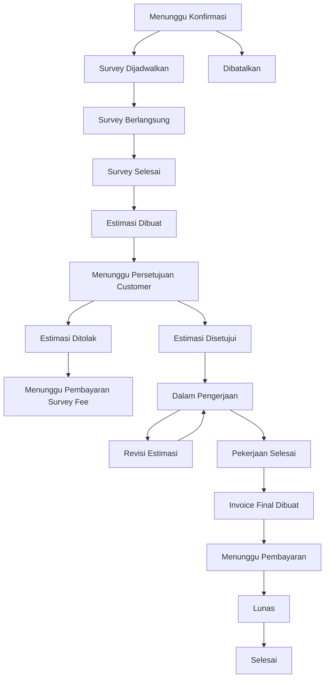
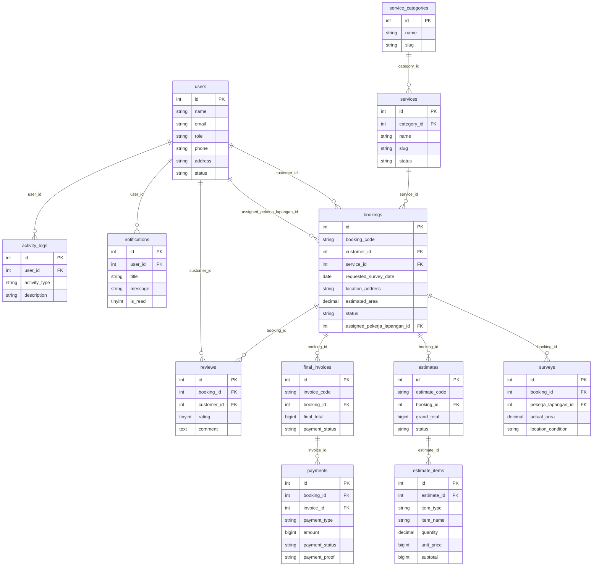
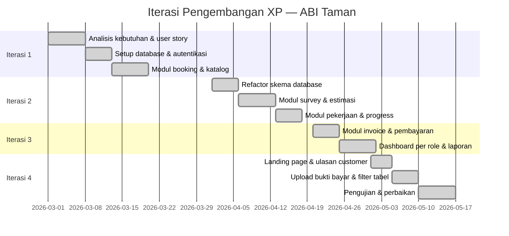
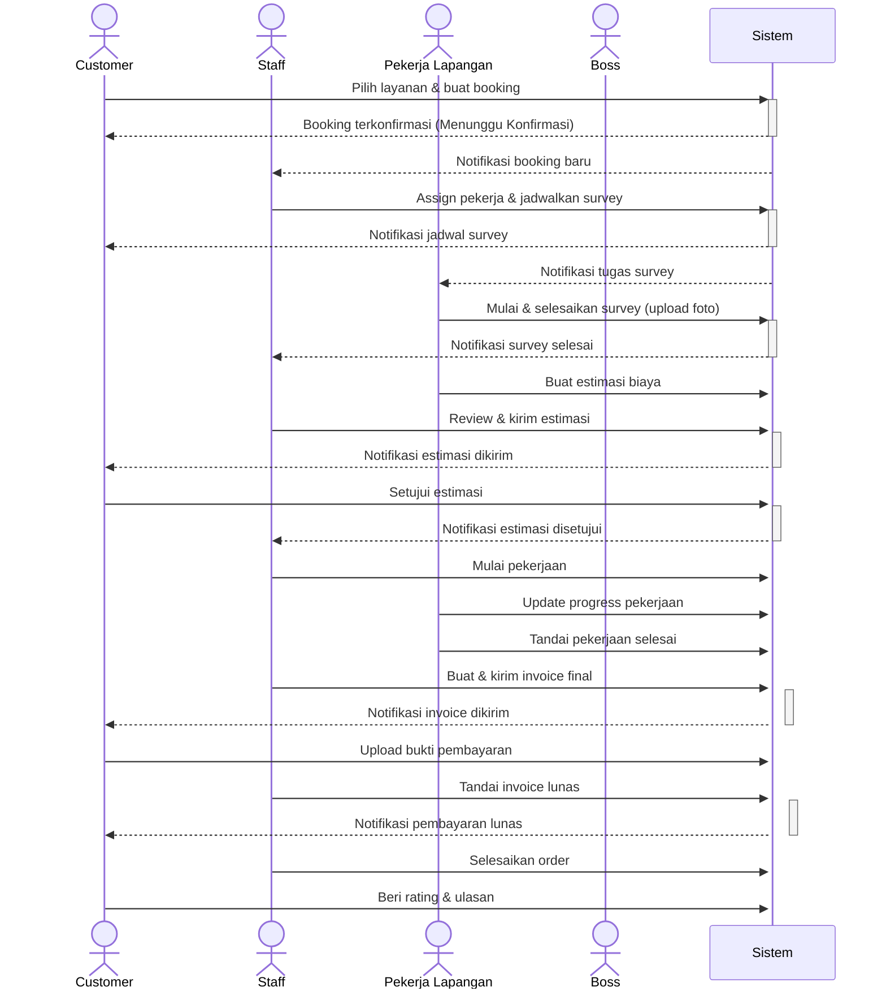

# ABI Taman — Aplikasi Reservasi dan Manajemen Pembuatan Taman

Aplikasi web untuk mengelola reservasi dan manajemen pembuatan taman secara end-to-end. Dibangun menggunakan PHP Native, MySQL, Bootstrap 5, dan JavaScript Vanilla. Dikembangkan sebagai studi kasus skripsi dengan metode **Extreme Programming (XP)**.

---

## Daftar Isi

- [Tentang Aplikasi](#tentang-aplikasi)
- [Tech Stack](#tech-stack)
- [Instalasi](#instalasi)
- [Akun Default](#akun-default)
- [Fitur Sistem](#fitur-sistem)
- [Alur Status Order](#alur-status-order)
- [Struktur Database](#struktur-database)
- [Metode Pengembangan: Extreme Programming](#metode-pengembangan-extreme-programming)
- [Diagram Sistem](#diagram-sistem)
- [Pengujian Black Box](#pengujian-black-box)
- [User Acceptance Testing](#user-acceptance-testing)

---

## Tentang Aplikasi

ABI Taman adalah perusahaan jasa pembuatan dan perawatan taman yang sebelumnya mengelola pemesanan secara manual melalui WhatsApp dan catatan fisik. Sistem ini dibangun untuk mendigitalisasi seluruh proses dari pemesanan hingga pembayaran.

**Permasalahan sebelum sistem:**
- Pemesanan tidak terstruktur, sering terjadi miskomunikasi
- Tidak ada transparansi estimasi biaya ke customer
- Sulit memantau progress pekerjaan di lapangan
- Laporan keuangan dibuat manual setiap bulan

**Solusi yang dibangun:**
- Booking online dengan alur status yang jelas
- Estimasi biaya otomatis setelah survey lapangan
- Dashboard monitoring real-time per role
- Laporan dan invoice yang bisa dicetak

---

## Tech Stack

| Komponen | Teknologi |
|---|---|
| Backend | PHP 8.x Native + PDO |
| Database | MySQL / MariaDB |
| Frontend | Bootstrap 5.3.3 CDN + Bootstrap Icons + Vanilla JavaScript |
| Auth | Session PHP + CSRF Token |
| Akses | Role-based Access Control (RBAC) |
| Upload | File lokal di `assets/uploads/` |

---

## Instalasi

**1. Clone dan konfigurasi environment**

```bash
git clone https://github.com/ruddypp/riski-yoga.git
cd riski-yoga
cp .env.example .env
```

Edit `.env` sesuai konfigurasi lokal:

```env
APP_NAME="ABI Taman"
APP_ENV=development
APP_DEBUG=true
APP_URL=http://localhost/riski

DB_HOST=127.0.0.1
DB_PORT=3306
DB_DATABASE=abi_taman
DB_USERNAME=rudy
DB_PASSWORD=ganteng

SESSION_NAME=abi_taman_session
TIMEZONE=Asia/Jakarta
```

**2. Setup database untuk paket client**

```bash
mysql -h127.0.0.1 -P3306 -uUSER -p -e \
  "CREATE DATABASE abi_taman CHARACTER SET utf8mb4 COLLATE utf8mb4_unicode_ci"
mysql -h127.0.0.1 -P3306 -uUSER -p abi_taman < database/abi_taman_client.sql
```

Dump client sudah mencakup struktur tabel dan data master yang dipakai aplikasi.
`database/refactor_schema.sql` dan `database/seed.php` disediakan untuk kebutuhan
pengembangan/demo, bukan sebagai sumber data master paket client.

**3. Permission folder upload**

```bash
bash scripts/fix_upload_permissions.sh
```

**4. Jalankan server**

```bash
php -S 127.0.0.1:8000
```

Buka `http://127.0.0.1:8000`

Bootstrap dan Bootstrap Icons dimuat langsung dari CDN. Proyek tidak memerlukan
Node.js, npm, Sass, atau proses build CSS.

### Import ulang data master ABI Taman (pengembangan)

Workbook final lokal berada di `dataabitaman/data abi taman exel.xlsx` dan tidak
disimpan di Git karena berisi data sumber serta dokumen kerja. Selalu jalankan
validasi tanpa perubahan terlebih dahulu:

```bash
php scripts/import_master_data.php
```

Jika laporan dry-run sudah sesuai, terapkan data master dan salin aset yang
tersedia:

```bash
php scripts/import_master_data.php --apply
```

Importer bersifat idempoten. Data master lama yang tidak ada di workbook final
dinonaktifkan, bukan dihapus. Untuk instalasi yang masih memiliki fitur Paket
Layanan, backup database lalu jalankan:

```bash
mysql abi_taman < database/migrations/20260727_remove_service_packages.sql
```

### Pemeriksaan regresi

```bash
php tests/run.php
find . -name '*.php' -type f -print0 | xargs -0 -n1 php -l
```

---

## Akun Default

| Role | Email | Password |
|---|---|---|
| Boss | abi@abitaman.id | boss123 |
| Staff | udin@abitaman.id | staff123 |
| Pekerja Lapangan | riski@abitaman.id | pekerja123 |
| Customer | yoga@email.com | user123 |

---

## Fitur Sistem

### Customer
- Lihat katalog layanan
- Booking layanan atau ajukan kebutuhan custom
- Upload foto referensi taman
- Lihat jadwal survey
- Setujui atau tolak estimasi biaya
- Upload bukti pembayaran
- Pantau progress pekerjaan real-time
- Lihat dan cetak invoice final
- Berikan rating dan ulasan setelah order selesai

### Staff
- Kelola booking masuk (terima / tolak)
- Assign pekerja lapangan dan jadwalkan survey
- Review dan kirim estimasi ke customer
- Mulai pekerjaan setelah estimasi disetujui
- Buat dan kirim invoice final
- Tandai pembayaran lunas
- Kelola master data (layanan, bahan, tarif tenaga kerja, biaya)
- Kelola user (customer, pekerja lapangan)
- Lihat laporan dan activity log

### Pekerja Lapangan
- Lihat jadwal survey yang ditugaskan
- Mulai dan selesaikan survey (upload foto before)
- Buat estimasi biaya dari hasil survey
- Update progress pekerjaan (persentase + foto)
- Buat revisi estimasi jika ada perubahan
- Kirim data final pekerjaan

### Boss
- Dashboard KPI: booking, pendapatan, estimasi, invoice
- Monitoring semua booking, pekerjaan, estimasi, invoice
- Monitoring kinerja pekerja lapangan
- Laporan pendapatan dengan filter periode, layanan, pekerja
- Export laporan ke CSV dan cetak PDF

---

## Alur Status Order



---

## Struktur Database



---

## Metode Pengembangan: Extreme Programming

Pengembangan aplikasi ini menggunakan metode **Extreme Programming (XP)** yang berfokus pada iterasi cepat, keterlibatan pengguna, dan kualitas kode yang terjaga.

### Nilai-nilai XP yang Diterapkan

| Nilai | Penerapan |
|---|---|
| Communication | Diskusi langsung dengan pemilik ABI Taman untuk menentukan kebutuhan sistem |
| Simplicity | Desain database dan kode dibuat sesederhana mungkin tanpa over-engineering |
| Feedback | Setiap iterasi diuji dan dievaluasi sebelum lanjut ke iterasi berikutnya |
| Courage | Refactor total dilakukan saat arsitektur lama tidak memadai |
| Respect | Setiap role pengguna dihormati dengan akses dan tampilan yang sesuai |

### Praktik XP yang Diterapkan

| Praktik | Penerapan |
|---|---|
| Planning Game | User story dibuat bersama pemilik ABI Taman di awal setiap iterasi |
| Small Releases | Fitur dirilis bertahap per iterasi, bisa langsung diuji pengguna |
| Simple Design | Tidak ada abstraksi berlebihan, kode langsung ke tujuan |
| Refactoring | Dilakukan pada iterasi 2 saat skema database dirombak total |
| Continuous Integration | Setiap perubahan langsung di-commit dan di-push ke repository |
| Collective Ownership | Semua modul bisa dimodifikasi tanpa bergantung pada satu developer |
| Coding Standards | Konsistensi penamaan fungsi, variabel, dan struktur file dijaga |
| Customer Tests | Pengujian dilakukan bersama pengguna nyata di setiap akhir iterasi |

### Iterasi Pengembangan



### User Story

| ID | Role | User Story | Status |
|---|---|---|---|
| US-01 | Customer | Saya ingin melihat katalog layanan beserta harga agar bisa memilih sesuai kebutuhan | ✓ Done |
| US-02 | Customer | Saya ingin melakukan booking layanan secara online tanpa harus datang langsung | ✓ Done |
| US-03 | Customer | Saya ingin mengetahui estimasi biaya sebelum pekerjaan dimulai | ✓ Done |
| US-04 | Customer | Saya ingin menyetujui atau menolak estimasi yang diberikan | ✓ Done |
| US-05 | Customer | Saya ingin memantau progress pekerjaan taman saya secara real-time | ✓ Done |
| US-06 | Customer | Saya ingin mengirim bukti pembayaran melalui sistem | ✓ Done |
| US-07 | Customer | Saya ingin memberikan ulasan dan rating setelah pekerjaan selesai | ✓ Done |
| US-08 | Staff | Saya ingin menerima dan mengelola booking yang masuk dengan mudah | ✓ Done |
| US-09 | Staff | Saya ingin menugaskan pekerja lapangan ke setiap booking | ✓ Done |
| US-10 | Staff | Saya ingin membuat dan mengirim invoice final ke customer | ✓ Done |
| US-11 | Staff | Saya ingin menandai pembayaran customer sebagai lunas | ✓ Done |
| US-12 | Pekerja Lapangan | Saya ingin melihat jadwal survey yang ditugaskan kepada saya | ✓ Done |
| US-13 | Pekerja Lapangan | Saya ingin mengisi hasil survey dan mengunggah foto lokasi | ✓ Done |
| US-14 | Pekerja Lapangan | Saya ingin membuat estimasi biaya berdasarkan hasil survey | ✓ Done |
| US-15 | Pekerja Lapangan | Saya ingin melaporkan progress pekerjaan secara berkala | ✓ Done |
| US-16 | Boss | Saya ingin melihat laporan pendapatan dan kinerja bisnis secara keseluruhan | ✓ Done |
| US-17 | Boss | Saya ingin memantau semua booking dan pekerjaan yang sedang berjalan | ✓ Done |

---

## Diagram Sistem

### Use Case Diagram

```mermaid
graph TD
    subgraph Sistem ABI Taman
        UC1[Lihat Katalog]
        UC2[Booking Layanan]
        UC3[Setujui Estimasi]
        UC4[Upload Bukti Bayar]
        UC5[Beri Ulasan]
        UC6[Kelola Booking]
        UC7[Jadwalkan Survey]
        UC8[Buat Invoice]
        UC9[Tandai Lunas]
        UC10[Hasil Survey]
        UC11[Buat Estimasi]
        UC12[Update Progress]
        UC13[Monitoring KPI]
        UC14[Lihat Laporan]
    end

    Customer --> UC1
    Customer --> UC2
    Customer --> UC3
    Customer --> UC4
    Customer --> UC5

    Staff --> UC6
    Staff --> UC7
    Staff --> UC8
    Staff --> UC9

    PekerjaLapangan[Pekerja Lapangan] --> UC10
    PekerjaLapangan --> UC11
    PekerjaLapangan --> UC12

    Boss --> UC13
    Boss --> UC14
```



### Sequence Diagram — Alur Booking



---

## Pengujian Black Box

### Modul Autentikasi

| No | Skenario | Input | Expected Output | Hasil |
|---|---|---|---|---|
| 1 | Login dengan kredensial valid | Email & password benar | Redirect ke dashboard sesuai role | Sesuai |
| 2 | Login dengan password salah | Email benar, password salah | Pesan error "Email atau password salah" | Sesuai |
| 3 | Login dengan email tidak terdaftar | Email tidak ada di database | Pesan error "Email atau password salah" | Sesuai |
| 4 | Akses halaman dashboard tanpa login | URL dashboard langsung | Redirect ke halaman login | Sesuai |
| 5 | Logout | Klik tombol logout | Session dihapus, redirect ke login | Sesuai |

### Modul Booking

| No | Skenario | Input | Expected Output | Hasil |
|---|---|---|---|---|
| 6 | Booking layanan valid | Semua field diisi lengkap | Booking tersimpan, status "Menunggu Konfirmasi" | Sesuai |
| 7 | Booking tanpa tanggal survey | Field tanggal kosong | Validasi error, form tidak terkirim | Sesuai |
| 8 | Booking tanpa alamat | Field alamat kosong | Validasi error, form tidak terkirim | Sesuai |
| 9 | Staff terima booking | Pilih pekerja & tanggal survey | Status berubah ke "Survey Dijadwalkan" | Sesuai |
| 10 | Staff tolak booking | Isi alasan penolakan | Status berubah ke "Dibatalkan" | Sesuai |

### Modul Survey & Estimasi

| No | Skenario | Input | Expected Output | Hasil |
|---|---|---|---|---|
| 11 | Pekerja mulai survey | Klik tombol mulai survey | Status berubah ke "Survey Berlangsung" | Sesuai |
| 12 | Pekerja selesaikan survey | Isi form + upload foto | Status berubah ke "Survey Selesai" | Sesuai |
| 13 | Buat estimasi valid | Isi semua field estimasi | Estimasi tersimpan dengan status "Draft" | Sesuai |
| 14 | Staff kirim estimasi | Klik review & kirim | Status estimasi "Dikirim", customer dapat notifikasi | Sesuai |
| 15 | Customer setujui estimasi | Klik setujui | Status berubah ke "Estimasi Disetujui" | Sesuai |
| 16 | Customer tolak estimasi | Klik tolak + isi catatan | Status berubah ke "Estimasi Ditolak" | Sesuai |

### Modul Invoice & Pembayaran

| No | Skenario | Input | Expected Output | Hasil |
|---|---|---|---|---|
| 17 | Buat invoice final | Staff klik buat invoice | Invoice tersimpan dengan status "Draft" | Sesuai |
| 18 | Kirim invoice ke customer | Staff klik kirim invoice | Status invoice "Dikirim", customer dapat notifikasi | Sesuai |
| 19 | Customer upload bukti bayar | Upload foto transfer | Bukti tersimpan, staff dapat notifikasi | Sesuai |
| 20 | Staff tandai lunas | Klik tandai lunas | Status pembayaran "Lunas", booking "Lunas" | Sesuai |
| 21 | Cetak invoice | Klik tombol cetak | Halaman print terbuka dengan format invoice | Sesuai |

### Modul Laporan

| No | Skenario | Input | Expected Output | Hasil |
|---|---|---|---|---|
| 22 | Filter laporan per periode | Pilih tanggal mulai & akhir | Data laporan sesuai periode yang dipilih | Sesuai |
| 23 | Export CSV | Klik export CSV | File CSV terunduh dengan data tabel | Sesuai |
| 24 | Cetak laporan PDF | Klik cetak/PDF | Browser print dialog terbuka, sidebar tersembunyi | Sesuai |
| 25 | Filter laporan per layanan | Pilih layanan tertentu | Data hanya menampilkan layanan yang dipilih | Sesuai |

### Modul Ulasan

| No | Skenario | Input | Expected Output | Hasil |
|---|---|---|---|---|
| 26 | Customer beri ulasan setelah selesai | Rating 1-5 + komentar | Ulasan tersimpan, muncul di detail booking | Sesuai |
| 27 | Ulasan tanpa rating | Submit tanpa pilih bintang | Validasi error, form tidak terkirim | Sesuai |
| 28 | Akses form ulasan sebelum selesai | Booking belum "Selesai" | Form ulasan tidak ditampilkan | Sesuai |

---

## User Acceptance Testing

Pengujian penerimaan pengguna dilakukan terhadap 8 responden yang terdiri dari pemilik ABI Taman, 2 staff operasional, 2 pekerja lapangan, dan 3 customer.

### Metode Pengujian

Responden diminta mencoba langsung aplikasi sesuai role masing-masing, kemudian mengisi kuesioner dengan skala **1–5** (1 = Sangat Tidak Setuju, 5 = Sangat Setuju).

### Hasil UAT per Aspek

| No | Aspek Penilaian | Staff | Pekerja Lapangan | Customer | Rata-rata |
|---|---|---|---|---|---|
| 1 | Tampilan aplikasi mudah dipahami | 4.5 | 4.0 | 4.7 | 4.4 |
| 2 | Proses booking mudah dilakukan | — | — | 4.8 | 4.8 |
| 3 | Informasi status order jelas | 4.5 | 4.3 | 4.6 | 4.5 |
| 4 | Fitur estimasi membantu pengambilan keputusan | 4.7 | 4.5 | 4.8 | 4.7 |
| 5 | Notifikasi sistem berjalan dengan baik | 4.3 | 4.2 | 4.5 | 4.3 |
| 6 | Laporan dan data mudah dibaca | 4.8 | — | — | 4.8 |
| 7 | Sistem membantu pekerjaan sehari-hari | 4.6 | 4.4 | 4.5 | 4.5 |
| 8 | Sistem layak digunakan secara nyata | 4.7 | 4.5 | 4.8 | 4.7 |
| | **Rata-rata keseluruhan** | **4.6** | **4.3** | **4.7** | **4.5** |

### Kesimpulan UAT

Berdasarkan hasil UAT dengan rata-rata nilai **4.5 dari 5.0**, sistem dinyatakan **diterima dan layak digunakan** oleh seluruh kelompok pengguna. Seluruh responden menyatakan sistem membantu proses kerja dan lebih efisien dibandingkan cara manual sebelumnya.

Catatan dari responden:
- Staff: "Proses assign pekerja dan jadwal survey jadi lebih cepat dan tidak ada yang terlewat"
- Pekerja Lapangan: "Mudah update progress dari HP, tidak perlu lapor manual ke kantor"
- Customer: "Bisa pantau taman saya dikerjakan sampai mana, tidak perlu tanya-tanya terus"
- Pemilik: "Laporan pendapatan langsung bisa dilihat kapan saja, tidak perlu rekap manual"

---

## Perhitungan Estimasi

```
jumlah_blok        = ceil(luas_area / 10)
durasi_total       = durasi_per_10m × jumlah_blok
bahan_total        = SUM(qty_material_terpilih × harga_satuan)
upah_tukang_total  = jumlah_tukang × durasi_total × upah_per_hari
grand_total        = bahan + tukang + biaya_tambahan
```

---

## Struktur Folder

```
riski/
├── api/
│   └── app.php              # API endpoint semua aksi POST
├── app/
│   └── helpers/
│       └── estimator.php    # Kalkulasi estimasi biaya
├── assets/
│   ├── js/app.js
│   ├── img/
│   └── uploads/             # File upload (foto, bukti bayar)
├── config/
│   ├── app.php              # Konfigurasi aplikasi
│   └── database.php         # Koneksi database
├── data/
│   └── session_helper.php   # Helper session, auth, query
├── database/
│   ├── refactor_schema.sql  # Schema database final
│   └── seed.php             # Data awal
├── docs/                    # Dokumentasi diagram
├── pages/                   # Halaman dashboard per modul
├── partials/                # Komponen UI (header, sidebar, dll)
├── index.php                # Landing page publik
├── catalog.php              # Katalog layanan publik
├── booking_create.php       # Form booking customer
├── dashboard.php            # Dashboard utama (semua role)
├── invoice_print.php        # Halaman cetak invoice
├── login.php                # Halaman login
└── logout.php               # Proses logout
```

---

## Lisensi

Dibuat untuk keperluan skripsi. Studi kasus: **ABI Taman**.
